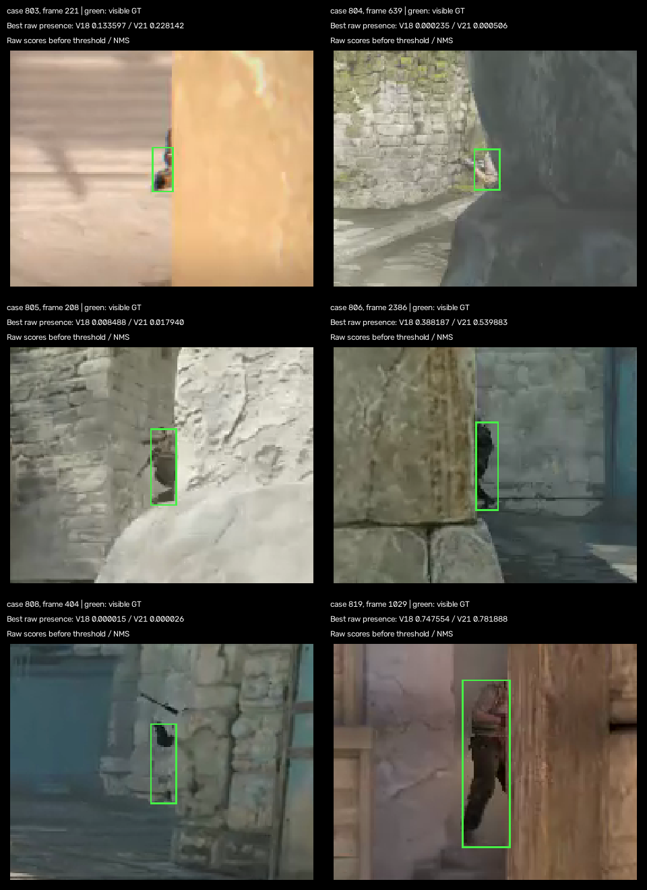

# V20/V21: проверка адаптации оценки присутствия

18 ноября 2026. Основа: `handoff/early-occlusion-2026-11-18`, коммит `bcb932300c6c86a2737c4d4b83ce64d3bb63a75e`. Рабочая ветка: `research/early-occlusion-next`.

**V18 воспроизведена. Преимущество нового кандидата V21 на новых матчах не подтвердилось; заменять им V18 оснований нет.** При одинаковом лимите 30 ложных рамок на 609 пустых кадрах обе модели обнаружили первый фрагмент в 2/6 эпизодов и подтвердили игрока до полного выхода в 2/5 завершённых эпизодов. Ещё один эпизод обрывается до полного выхода: с ним подтверждение составляет 3/6 у обеих моделей. На порогах, выбранных заранее по старому набору, V21 дала 75 ложных рамок против 44 у V18 без прибавки первых обнаружений.

Полную независимость от исторического обучения V18 подтвердить нельзя: манифеста V14/V16/V18 нет, что подтвердил пользователь. Проверено отсутствие пересечения новых 20 матчей со всеми 45 опубликованными источниками, 18 матчами текущего дообучения и 17 матчами выбора кандидата/порогов. Это ограничение относится и к положительным, и к отрицательным результатам.

## Воспроизведение и диагностика V18

[CPU replay](evidence/next/v18-replay-cpu.json) совпал с исходным временным экспериментом по всем покейсным результатам: 3/9 первых рамок, 5/9 подтверждений, 9/9 хотя бы одна рамка при частичном перекрытии, 2/244 пустых кадра с рамками. Добавление движения ничего не улучшило. Совмещение фона успешно на 137/275 кадрах. Его дополнительная стоимость на CPU: медиана 6,118 мс, p95 6,868 мс; это не время полной модели. Проверены хеши двух исходных весов и 45 клипов.

Проверена предложенная в хэндофе гипотеза о слабых обучающих целях узких фрагментов. [Аудит назначения целей](evidence/next/assignment.json) использует исходный `PresenceAssigner`: TAL, alpha 0,5, beta 6, top-k 10, уровни с шагами 8/16/32/4. На 49 положительных кадрах:

- У всех 10 фрагментов шириной ≤8 пикселей на входе есть положительные anchors. Медиана максимальной целевой уверенности — 0,7201; ни в одном случае максимум не ниже 0,13.
- У двух из этих десяти нет положительных anchors P2. Само по себе это не означает отсутствия обучающего сигнала: другие уровни получают положительные цели.
- На всех 49 кадрах медиана максимальной цели — 0,7819, медиана суммарной массы целей — 3,621.

Гипотеза о повсеместном недостатке силы целей **не поддержана этой выборкой**. Наличие правильной геометрии среди плотной сетки рамок тоже не означает распознавания игрока: необходим сигнал, отделяющий его от фона.

## Выбранный подход и два кандидата

Проверила, достаточно ли целевой адаптации последнего слоя оценки присутствия, без изменения геометрии и уже выученных признаков. Заморожены все исходные параметры, кроме строки presence последних четырёх классификационных свёрток 1×1: всего **260 параметров**. Классы проверены: `0=T`, `1=CT`. Сеть получает только текущий RGB-кадр; подтверждение использует текущую и предыдущую детекции. Будущие кадры, игровые события, ticks, GSI, звук и память игры не используются. Будущие видеокадры просматривались только для эталонной разметки полного выхода.

Кеш признаков строится на старых 83 размеченных кадрах из 18 матчей: 49 положительных и 34 отрицательных. Для каждого кадра оставлены все anchors с IoU ≥0,1 или назначенной положительной целью, 512 наиболее уверенных фоновых кандидатов и 512 случайных anchors, seed 42. Положительная и отрицательная масса нормируются отдельно внутри кадра. Обучение — Adam, lr 0,002, 400 шагов; к BCE добавляется штраф за квадрат изменения логита относительно V18. Это обучение головы на сохранённых признаках, не полное обучение детектора.

| Эксперимент | Цель / штраф | Выбор по старым матчам |
|---|---|---|
| V20 | Жёсткая цель 1 для замороженной рамки с IoU ≥0,3; λ=0,01 | Отвергнута: при 47 ложных кадрах 5/17 первых обнаружений против 7/17 у V18; потребовался порог около 0,988 |
| V21 | Мягкая цель TAL только для назначенных положительных anchors; λ=0,1 | Выбрана до просмотра нового теста: при 19 ложных рамках 7/17 первых и 10/17 подтверждений против 5/17 и 7/17 у V18 |

На старом наборе при 45 ложных рамках обе модели дают 7/17 первых и 10/17 подтверждений. При одинаковых 47 **ложных кадрах** V21 даёт 8/17 первых против 7/17, но 62 **рамки** против 56. Поэтому равенство числа кадров не подменяет равенство бюджета рамок.

Артефакты: [V20](checkpoints/v20-presence.pt), [метаданные V20](checkpoints/v20-presence.json), [development V20](evidence/next/development.json), [V21](checkpoints/v21-presence.pt), [метаданные V21](checkpoints/v21-presence.json), [development V21](evidence/next/v21-development.json), [фиксация кандидата](evidence/next/frozen-candidate.json). Исходные `train_args`/`train_metrics` внутри checkpoint унаследованы от V18 и **не являются метриками нового обучения**; новое обучение описывает `early_fragment_training` и JSON рядом с весами. Поля `positive_iou`/`ignored_iou` внутри зафиксированного V21 относятся к прежнему варианту с жёсткими целями; для V21 действует `target=tal`, точный рецепт описан в sidecar и коде. В sidecar исправлен подсчёт положительных anchors: 490 ненулевых целей, масса 186,953; веса не изменялись.

Старая CPU-проверка даёт 47 ложных кадров вместо 46 в исходном CUDA-отчёте. Кроме того, новое строгое требование точности первой рамки в паре снижает старое подтверждение V18 с 11 до 10. Это отдельное измерение с другим backend/критерием, а не точное воспроизведение старой таблицы. Точное совпадение replay выше относится к девяти эпизодам временного эксперимента.

## Новые матчи и протокол

Источники — [OpenCS2](https://huggingface.co/datasets/blanchon/opencs2_dataset), Julien Blanchon, [CC BY 4.0](https://creativecommons.org/licenses/by/4.0/). Использованы только публичные `video.mp4`. Манифест содержит точные URL, длины и SHA-256. В производных изображениях добавлены кроп, увеличение, подписи и рамки разметки.

Из каталога исключены опубликованные match_id; остальные отсортированы по SHA-256 строки `early-2026-11-18:` + путь. Для каждого взяты первая по алфавиту карта, round 07, player 02. Первые 12 матчей дали только пять подходящих эпизодов. До просмотра результатов их прогона выборка расширена до 20 матчей; решение записано в фиксации кандидата. Разметка расширения завершена до раскрытия результатов; V21 и development-пороги не менялись.

Карты исходников: Ancient 9, Anubis 4, Inferno 3, Dust2 3, Nuke 1. После просмотра пикселей отобраны **6 эпизодов из 6 матчей**, 20 частичных кадров и **609 пустых кадров** из всех 20 матчей. Положительные эпизоды: Ancient 4 и Dust2 2. Это небольшой вручную проверенный пилот, не репрезентативная случайная выборка выходов. Обзор не был исчерпывающей разметкой каждого кадра всех раундов. Правило первой карты внесло смещение состава.

Разметка выполнена без предсказаний одним аннотатором; возможна ошибка около кадра или 1–2 пикселей. Отдельно записаны причины исключений: выход из дыма, появление на границе прицела, смена масштаба, появление уже целого тела. Для каждого зачтённого частичного кадра размечена видимая часть тела без оружия. В эпизоде 808 прямоугольник охватывает раздельные фрагменты перчатки и ноги, включая промежуток между ними.

- Первый кадр засчитывается при IoU ≥0,30 с видимой рамкой именно этого кадра.
- Подтверждение требует двух последовательных связанных рамок, **каждая** с IoU ≥0,30 со своей покадровой разметкой. Попадания в широкую ROI недостаточно.
- Полный выход — всё тело за пределами твёрдого укрытия. Эпизод 803 цензурирован: нижняя часть остаётся закрыта до смены прицела. Он учитывается отдельно от полного выхода.
- В 819 имеется один частичный кадр; подтверждение из двух кадров до полного выхода физически невозможно. Из пяти завершённых эпизодов возможность такого подтверждения есть у четырёх.
- Ложная рамка — отдельный выход после NMS на проверенном пустом кадре. Дубликаты во времени считаются снова. Это не число ложных треков и не оценка ошибок на всех кадрах матча: лишние рамки на положительных кадрах этим бюджетом не измеряются.

[Разметка](data/next/benchmark.json) · [Источники](data/next/sources.json) · [Правило отбора](data/next/selection.json). Первоначальные 12 матчей и их предварительный прогон сохранены отдельно с `initial-12` / `new-comparison.json`; итоговый набор и результат — `benchmark.json` / `new20-comparison.json`.

## Итог при одинаковом лимите ложных рамок

| Лимит рамок на 609 пустых кадров | V18: первый /6 | V21: первый /6 | V18 / V21: подтверждение в частичном интервале /6 | V18 / V21: до полного выхода /5 |
|---:|---:|---:|---:|---:|
| 0 | 1 | 1 | 3 / 3 | 2 / 2 |
| 6 | 2 | 2 | 3 / 3 | 2 / 2 |
| 30 | 2 | 2 | 3 / 3 | 2 / 2 |
| 73 | 3 | 3 | 3 / 3 | 2 / 2 |

Каждая модель использовала ровно указанный бюджет. Пороги для этих строк определены по отрицательным кадрам **самого теста**, без использования положительных ответов: это диагностические точки кривой качества, не независимая калибровка эксплуатационного порога. При лимите 30 пороги равны 0,181667 у V18 и 0,275342 у V21; у обеих 28 пустых кадров с рамками.

Отдельная честная проверка переноса заранее выбранных development-порогов: V18 0,13; V21 0,13754192. Обе дают 3/6 первых и 3/6 подтверждений в частичном интервале. У V18 44 рамки на 40 пустых кадрах, у V21 75 рамок на 66 кадрах. Наибольший вклад в ложные рамки V21 даёт пустое окно 817: 27 против 15 у V18; также ухудшились 820, 816 и 808.

При лимите 30 все шесть ранних/поздних исходов совпадают. Это отсутствие наблюдаемой прибавки, не доказательство эквивалентности моделей в целом: для доли 2/6 описательный интервал Уилсона 95% составляет примерно 9,7–70,0%. Из-за малого и отобранного пилота сильный вывод об обобщении невозможен.

[Полный результат](evidence/next/new20-comparison.json) · [Покейсный анализ](evidence/next/new20-analysis.json).

## Промахи и задержка в кадрах

Лучший raw presence среди **всех** anchors с IoU ≥0,3, без отсечения слабых оценок:

| Эпизод | Что видно первым | V18 | V21 | Максимальный IoU геометрии |
|---|---|---:|---:|---:|
| 803 | Голова/рукав в прицеле у жёлтого угла | 0,133597 | 0,228142 | 0,920 |
| 804 | Рука у каменного угла, остаточная вспышка | 0,000235 | 0,000506 | 0,761 |
| 805 | Бок и ноги прыгающего игрока | 0,008488 | 0,017940 | 0,774 |
| 806 | Узкий профиль у камня | 0,388187 | 0,539883 | 0,803 |
| 808 | Перчатка и отделённый фрагмент ноги | 0,000015 | 0,000026 | 0,898 |
| 819 | Половина тела из-за доски | 0,747554 | 0,781888 | 0,945 |

Таким образом, в тяжёлых промахах 804/805/808 подходящая геометрия доступна, но простая адаптация линейной строки лишь повышает слабый сигнал примерно вдвое. Этого недостаточно относительно фона. Это поддерживает гипотезу о недостаточной различимости фрагментов в замороженных признаках/классификаторе; таблица не доказывает конкретную внутреннюю причину сети.



При лимите 30 рамок задержки обеих моделей от первого различимого кадра одинаковы:

| Эпизод | Первая точная рамка, мс | Подтверждение, мс | Полный выход после первого кадра, мс |
|---|---:|---:|---:|
| 803 | 62,5 | 93,75 | Не наблюдался |
| 804 | 31,25 | Нет до выхода | 62,5 |
| 805 | 31,25 | Нет до выхода | 62,5 |
| 806 | 0 | 31,25 | 93,75 |
| 808 | 62,5 | 93,75 | 125 |
| 819 | 0 | Нет до выхода | 31,25 |

Медиана первой точной рамки — 31,25 мс, максимум — 62,5 мс; все 6 найдены до конца частичного интервала. Медиана подтверждения среди трёх успешных — 93,75 мс; три не подтверждены. Эти времена не включают вычисление модели. Успешные подтверждения в двух завершённых эпизодах опережают полный выход на 62,5 и 31,25 мс.

При лимите 6 V21 на один кадр раньше находит и подтверждает 803; при нулевом бюджете тоже ускоряет его и находит 805 до выхода. Это ограниченные изменения задержки при тех же первых обнаружениях и подтверждениях, а не общий выигрыш по целевой метрике. При заранее фиксированных порогах 803 подтверждается V21 на 62,5 мс раньше, ценой роста ложных рамок на всём наборе.

Проверки чувствительности при лимите 30: IoU 0,2, 0,3, 0,5 и расширение GT на 2 пикселя дают у обеих моделей одинаковые 2/6 первых и 3/6 подтверждений в частичном интервале. Неопределённость номера первого кадра не устранена: выполнена одна независимая от предсказаний разметка, без второго аннотатора.

[Неотсечённые raw scores](evidence/next/raw-firsts-unfiltered.json) · [IoU 0,2](evidence/next/sensitivity-iou02.json) · [IoU 0,5](evidence/next/sensitivity-iou05.json) · [GT +2 px](evidence/next/sensitivity-pad2.json).

## Время выполнения и проверка реализации

CPU FP32, macOS 26.2 arm64, Python 3.11.16, PyTorch 2.11.0, Ultralytics 8.4.178, NumPy 2.4.6, OpenCV 5.0.0. В текущем процессе CUDA/MPS недоступны. Torch — 2 потока, OpenCV — 1. Точная модель процессора не получена; результаты не переносятся на исходный RTX 4060 Laptop.

Полные независимые прогоны двух моделей на одинаковых 10 кадрах: 3 прогрева каждой, 4 повтора, чередование порядка V18/V21. Включены обе стадии resize, подготовка tensor, полный forward, декодирование рамок, фильтр и NMS. Не включены чтение видео/захват, загрузка, вывод на экран и ожидание второго кадра.

| Модель | Измерений | Медиана, мс | p95, мс | Максимум, мс |
|---|---:|---:|---:|---:|
| V18 | 40 | 213,823 | 226,871 | 229,267 |
| V21 | 40 | 214,493 | 245,006 | 336,869 |

Медиана парной разницы V21−V18 — −0,029 мс; считать V21 быстрее оснований нет. На этом CPU обработка значительно дольше интервала источника 31,25 мс. Время появления рамки в записи и вычислительная задержка — разные показатели; живое управление и работа одновременно с игрой не измерялись.

Для массового сравнения использован один forward V18 и пересчёт четырёх строк presence на тех же признаках. Этот shortcut **не использован для замера времени**. На четырёх кадрах сравнение с настоящим полным forward V21 дало максимальное различие presence 2,19×10⁻¹⁰; геометрия, T/CT и keypoints совпали побитно. Повтор кадра после другого изображения не изменил результат: скрытого состояния/зависимости от будущего нет.

Четыре регрессионных теста проверяют бюджет рамок и одинаковые оценки на границе порога, строгую последовательную точность подтверждения, отсутствие пересечения опубликованных источников и целостность покадровой разметки. SHA-256 всех 20 новых исходников проверены. Скрипт сборки команд проверен `bash -n`; вычислительные этапы выполнены отдельными командами. [Замер и проверки эквивалентности](evidence/next/latency-cpu.json).

## Воспроизведение и сохранённые веса

Установка: Python 3.11, PyTorch 2.11.0 и torchvision 0.26.0 под выбранную платформу, затем `pip install -r research/early-occlusion/requirements.txt`. Для этих результатов нужен CPU FP32. Все пути команд ниже — от корня репозитория.

```bash
# Оценка сохранённой V21, скачивание ровно записанных источников (~1,15 GB).
bash research/early-occlusion/src/run-next.sh

# Дополнительно повторить аудит и обучение V20/V21, затем оценить заново.
# Используй другой рабочий каталог, чтобы кеши разных весов не смешивались.
EXPERIMENT_WORK="$PWD/work/early-occlusion-retrained" \
  bash research/early-occlusion/src/run-next.sh --retrain

# На использованной локальной установке Python требуется bundled libexpat:
DYLD_LIBRARY_PATH="$PWD/.venv/expat/lib" \
  bash research/early-occlusion/src/run-next.sh
```

Скрипт сохраняет новые отчёты в `work/early-occlusion-reproduction/reports`, логи — рядом. `EXPERIMENT_PYTHON` позволяет указать другой Python. Оценка может использовать кеш только при совпадении хешей весов, разметки и источников; несовпадение — ошибка. Старые development-кеши до добавления хеша источников не переиспользуются автоматически. Для воспроизведения загрузки нужен `--manifest`; динамический `--count` предназначен только для новой коллекции.

Основные прямые команды:

```bash
.venv/bin/python research/early-occlusion/src/audit-fragments.py \
  --output work/assignment.json --features work/features.pt
.venv/bin/python research/early-occlusion/src/train-presence-head.py \
  --features work/features.pt --target tal --regularization .1 \
  --output work/v21-presence.pt
.venv/bin/python research/early-occlusion/src/compare-presence.py \
  --candidate research/early-occlusion/checkpoints/v21-presence.pt \
  --benchmark new --annotations research/early-occlusion/data/next/benchmark.json \
  --sources research/early-occlusion/data/next/sources.json \
  --media work/early-occlusion-next/new-matches \
  --cache work/early-occlusion-next/final20-predictions.pt \
  --calibration-report research/early-occlusion/evidence/next/v21-development.json \
  --output work/new20-comparison.json
```

SHA-256 сохранённых весов:

- V18: `8fded5609c51faa1b758c4b06f52d8a7e6a33f10e5677c072a40bc89a20ca677`.
- V21: `27ae877c8e358713a862ab221d96bc2135d8318a50cd5617815b9a8b08448feb`.

V20 и V21 сохранены как результаты исследований. V18 остаётся базой. Следующая поддержанная результатами гипотеза — обучать различающие признаки фрагмента с более разнообразными парными фонами и контрастными/частично закрытыми примерами, сохраняя отдельную проверку геометрии. Повторять одно повышение уверенности на тех же замороженных признаках оснований мало. Для проверки следующего подхода эти 20 матчей уже являются просмотренными: потребуется новая партия и, по возможности, восстановление происхождения исходного обучения. Полное обучение признаков в данном эксперименте не выполнялось.
